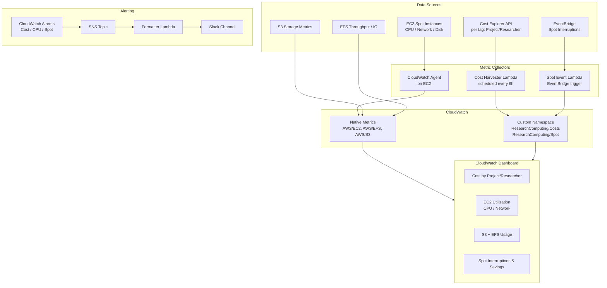

# Implementation Plan — Research Computing CloudWatch Dashboard

## Problem Statement

Build a Terraform-managed CloudWatch monitoring solution for genomics/bioinformatics research
workloads on AWS (EC2 spot instances, pipeline tools like Nextflow/Snakemake, S3, EFS). The
solution must provide combined cost attribution and resource utilization visibility for
researchers, ops, and finance — with Slack alerting for threshold breaches — starting from a
greenfield multi-account AWS Organizations environment with no existing tagging.

## Requirements

- **Workloads:** Genomics/bioinformatics on EC2 spot instances, pipeline orchestrators (Nextflow/Snakemake), S3, EFS
- **Goal:** Combined cost attribution (by project/researcher) + resource utilization monitoring
- **Audiences:** Researchers (self-service), ops (operational health), finance (cost reporting)
- **Alerting:** SNS → Slack via Lambda webhook
- **IaC:** Terraform
- **Account structure:** Multi-account (AWS Organizations), cost aggregated from member accounts
- **Tagging:** Greenfield — tagging strategy defined as part of this work

## Background

- AWS Cost Explorer API does not emit native CloudWatch metrics, so a scheduled Lambda function
  must pull cost-by-tag data and publish custom CloudWatch metrics.
- The `aws_cloudwatch_dashboard` Terraform resource accepts a JSON body, enabling fully
  code-driven dashboards.
- SNS → Lambda → Slack webhook is the standard pattern for formatted CloudWatch alarm
  notifications.
- For multi-account cost aggregation, the AWS Organizations management account has access to
  Cost Explorer across all member accounts; cross-account CloudWatch metric sharing uses
  CloudWatch Observability Access Manager (OAM).
- EC2 spot instance interruption events are emitted as EventBridge events
  (`EC2 Spot Instance Interruption Warning`) — these feed CloudWatch custom metrics and alarms.

## Tagging Strategy

All tags are applied globally via Terraform `default_tags` on the AWS provider and enforced
through the `modules/tagging` validation module.

| Tag Key      | Example Values                    | Purpose                            |
|--------------|-----------------------------------|------------------------------------|
| `Project`    | `genome-seq-2026`, `protein-fold` | Cost attribution by research project |
| `Researcher` | `jsmith`, `alee`                  | Per-user cost tracking             |
| `Team`       | `computational-bio`, `bioinformatics` | Departmental rollup            |
| `Environment`| `prod`, `dev`                     | Separate dev/test spend            |
| `Pipeline`   | `nextflow`, `snakemake`           | Toolchain attribution              |
| `CostCenter` | `CC-4821`                         | Finance charge-back                |

## Architecture



## Project Structure

```
.
├── PLAN.md
├── README.md
├── main.tf                        # Root module — wires sub-modules together
├── variables.tf                   # Root-level input variables
├── outputs.tf                     # Dashboard URL, SNS ARN, Lambda names
├── versions.tf                    # Terraform + provider version constraints
├── providers.tf                   # AWS provider(s) with default_tags + assume_role
├── terraform.tfvars.example       # Example variable values
├── modules/
│   ├── tagging/                   # Tag validation and map construction
│   ├── cost_allocation_tags/      # Cost Explorer tag activation
│   ├── cost_harvester/            # Lambda: Cost Explorer → CloudWatch metrics
│   │   └── lambda/
│   │       ├── handler.py
│   │       └── test_handler.py
│   ├── spot_tracker/              # Lambda: EventBridge → CloudWatch metrics
│   │   └── lambda/
│   │       ├── handler.py
│   │       └── test_handler.py
│   ├── dashboard/                 # CloudWatch Dashboard (all panels)
│   │   └── templates/
│   │       └── dashboard.json.tpl
│   ├── alarms/                    # CloudWatch Alarms
│   ├── notifications/             # SNS + Slack Lambda
│   │   └── lambda/
│   │       ├── handler.py
│   │       └── test_handler.py
│   └── oam/                       # CloudWatch OAM sink + links
└── policies/
    └── require_project_tag_scp.json  # Organizations SCP
```

---

## Task Breakdown

### Task 1: Terraform project scaffold and tagging module

**Objective:** Create the Terraform project structure with a reusable tagging module that
enforces required tags across all resources.

**Implementation:**
- Initialize Terraform project with `versions.tf`, `providers.tf` (multi-account via
  `assume_role`), and a `modules/tagging` module that produces a validated tag map.
- Use `default_tags` on the AWS provider.
- Define required tag keys: `Project`, `Researcher`, `Team`, `Environment`, `Pipeline`,
  `CostCenter`.

**Tests:** `terraform validate` and `terraform plan` pass with no errors; `default_tags`
propagate to a test resource.

**Demo:** Running `terraform plan` produces a plan where every resource shows the required tags
without manual repetition.

---

### Task 2: Activate Cost Allocation Tags and Cost Explorer baseline

**Objective:** Enable the tagging keys in AWS Cost Explorer so cost-by-tag reporting works.

**Implementation:**
- Use `aws_ce_cost_allocation_tag` Terraform resource to activate each tag key in the
  management account.
- Add a data source that queries Cost Explorer to validate tag activation.
- Document the 24-hour delay before tag data appears.

**Tests:** `terraform apply` succeeds; AWS console confirms tags are active under
Billing → Cost Allocation Tags.

**Demo:** Cost Explorer console shows the research tags as filterable dimensions.

---

### Task 3: Cost Harvester Lambda + custom CloudWatch metrics

**Objective:** Pull per-tag cost data from Cost Explorer API and publish it as custom
CloudWatch metrics on a schedule.

**Implementation:**
- Python Lambda (`modules/cost_harvester`) calls `ce:GetCostAndUsage` grouped by `Project`
  and `Researcher` tags.
- Publishes metrics to the `ResearchComputing/Costs` namespace.
- Scheduled via EventBridge rule (every 6 hours).
- Least-privilege IAM role: `ce:GetCostAndUsage`, `cloudwatch:PutMetricData`.
- Packaged and deployed via `aws_lambda_function` + `archive_file`.

**Tests:** Unit tests with mocked boto3 responses; integration test by invoking manually and
checking CloudWatch for published metrics.

**Demo:** CloudWatch Metrics console shows `ResearchComputing/Costs` with `DailySpend`
broken down by `Project` and `Researcher` dimensions.

---

### Task 4: Spot interruption tracker Lambda + EventBridge rule

**Objective:** Capture EC2 spot interruption events and publish custom metrics for
interruption frequency per project.

**Implementation:**
- EventBridge rule matching `EC2 Spot Instance Interruption Warning` events.
- Python Lambda reads the instance's `Project` tag via `ec2:DescribeInstances` and publishes
  a `SpotInterruption` count metric to `ResearchComputing/Spot`.
- Deployed via Terraform.

**Tests:** Lambda tested with a synthetic EventBridge event payload; metric published
successfully.

**Demo:** Simulated spot interruption event results in a visible metric data point in
CloudWatch.

---

### Task 5: CloudWatch Dashboard — cost and spot panels

**Objective:** Build the first two dashboard sections: cost attribution and spot interruption
summary.

**Implementation:**
- `aws_cloudwatch_dashboard` in Terraform using `templatefile()` JSON body.
- Widgets: (a) line chart of `DailySpend` by `Project` over 30 days, (b) single-value widgets
  for top spending researcher and project, (c) bar chart of `SpotInterruption` count by
  project.
- Project list parameterized via Terraform variable.

**Tests:** `terraform apply` succeeds; dashboard visible in CloudWatch console with correct
widgets.

**Demo:** Dashboard shows cost trends by project and spot interruption frequency.

---

### Task 6: CloudWatch Dashboard — EC2 utilization and storage panels

**Objective:** Add resource utilization panels (CPU, network, disk) and storage panels
(S3, EFS) to the dashboard.

**Implementation:**
- Widgets added: (a) EC2 `CPUUtilization` average by `Project` tag using metric math,
  (b) `NetworkIn`/`NetworkOut` for compute nodes, (c) S3 `BucketSizeBytes` and
  `NumberOfObjects` per research bucket, (d) EFS `PermittedThroughput` vs `MeteredIOBytes`.
- CloudWatch metric math expressions aggregate by tag where native tag-based filtering is not
  available.

**Tests:** Dashboard JSON is valid; widgets render without errors in CloudWatch console.

**Demo:** Full dashboard showing cost + utilization + storage in a single view, filterable by
project.

---

### Task 7: CloudWatch Alarms

**Objective:** Define alarms for cost spikes, idle resources, and spot interruption bursts.

**Implementation:**
- `aws_cloudwatch_metric_alarm` resources for:
  - (a) `DailySpend` exceeding configurable threshold per project
  - (b) `CPUUtilization` below 10% for >2 hours (idle/wasted resource)
  - (c) `SpotInterruption` count > 5 in 1 hour
- All alarms target a shared `aws_sns_topic`.
- Thresholds configurable via Terraform variables.

**Tests:** Alarm state transitions testable by temporarily lowering thresholds; SNS receives
notification.

**Demo:** Triggering a test alarm results in an SNS message published to the topic.

---

### Task 8: SNS → Lambda → Slack notification pipeline

**Objective:** Route CloudWatch alarm notifications to Slack with formatted, actionable
messages.

**Implementation:**
- Python Lambda receives SNS events, parses the CloudWatch alarm payload, and posts a
  formatted message to a Slack incoming webhook URL stored in AWS Secrets Manager.
- Message includes: alarm name, current value, threshold, affected project tag, link to
  dashboard.
- Lambda subscribed to SNS topic via `aws_sns_topic_subscription`.
- Deployed via Terraform.

**Tests:** Unit test message formatter; integration test by publishing a test SNS message and
verifying Slack receipt.

**Demo:** A triggered alarm posts a Slack message with project name, metric value, and direct
link to the CloudWatch dashboard.

---

### Task 9: Multi-account metric sharing via CloudWatch OAM

**Objective:** Aggregate metrics from member accounts into the monitoring account's dashboard.

**Implementation:**
- Monitoring account: CloudWatch OAM sink (`aws_oam_sink`).
- Each member/source account: OAM link (`aws_oam_link`) sharing metrics and logs to the sink.
- Dashboard updated to use cross-account metric queries (specifying `accountId` in widget
  metric arrays).
- Terraform `for_each` over account IDs.

**Tests:** `terraform apply` succeeds across monitoring + at least one source account;
cross-account metric appears in the monitoring account's dashboard.

**Demo:** A single dashboard in the monitoring account displays EC2 metrics sourced from
multiple member accounts.

---

### Task 10: Documentation, outputs, and cost tagging enforcement policy

**Objective:** Wire everything together with runbook documentation, Terraform outputs, and
an SCP to enforce tagging.

**Implementation:**
- `outputs.tf` exposing dashboard URL, SNS topic ARN, and Lambda function names.
- `README.md` covering: architecture diagram, required tag keys, how to add a new project,
  alarm threshold configuration, and Slack webhook rotation.
- AWS Organizations SCP (`aws_organizations_policy`) that denies EC2/S3 resource creation if
  the `Project` tag is missing.

**Tests:** All `terraform output` values resolve; README accurately reflects deployed
architecture.

**Demo:** End-to-end walkthrough — deploy with a new project tag, see cost metrics appear,
trigger an alarm, receive Slack notification, view cross-account dashboard.
