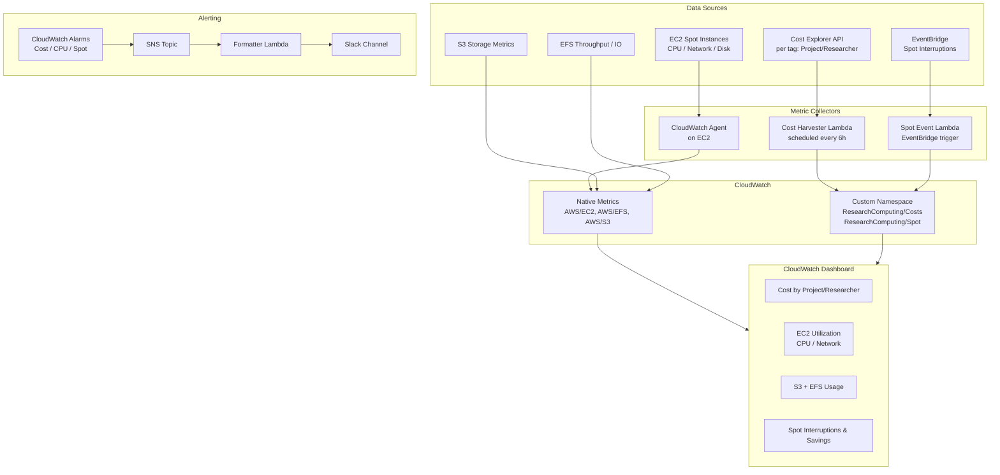

# Research Computing — CloudWatch Monitoring

Terraform-managed CloudWatch monitoring solution for genomics/bioinformatics research
workloads. Provides combined cost attribution and resource utilization visibility for
researchers, ops, and finance, with Slack alerting for threshold breaches.

## Architecture



## Project Structure

```
.
├── PLAN.md                        # Full implementation plan
├── README.md                      # This file
├── main.tf                        # Root module — wires sub-modules together
├── variables.tf                   # Root-level input variables
├── outputs.tf                     # Dashboard URL, SNS ARN, Lambda names
├── versions.tf                    # Terraform + provider version constraints
├── providers.tf                   # AWS providers with default_tags + assume_role
├── terraform.tfvars.example       # Example variable values
├── modules/
│   ├── tagging/                   # Tag validation and map construction
│   ├── cost_allocation_tags/      # Cost Explorer tag activation
│   ├── cost_harvester/            # Lambda: Cost Explorer → CloudWatch custom metrics
│   ├── spot_tracker/              # Lambda: EventBridge spot interruptions → metrics
│   ├── dashboard/                 # CloudWatch Dashboard (4 panel sections)
│   ├── alarms/                    # CloudWatch Alarms (cost, idle, spot burst)
│   ├── notifications/             # SNS topic + Slack Lambda notifier
│   └── oam/                       # CloudWatch OAM sink for multi-account metrics
└── policies/
    └── require_project_tag_scp.json  # Organizations SCP — enforces Project tag
```

## Prerequisites

- Terraform >= 1.6.0
- AWS CLI configured with credentials for the monitoring account
- An AWS Organizations management account (for Cost Explorer tag activation)
- IAM roles in the monitoring account and management account for Terraform to assume
- A Slack incoming webhook URL (created in your Slack workspace)

## Tagging Strategy

All resources are tagged via Terraform `default_tags`. The tagging module validates
that no required tag is empty at plan time.

| Tag Key      | Example Values                        | Purpose                              |
|--------------|---------------------------------------|--------------------------------------|
| `Project`    | `genome-seq-2026`, `protein-fold`     | Cost attribution by research project |
| `Researcher` | `jsmith`, `alee`                      | Per-user cost tracking               |
| `Team`       | `computational-bio`, `bioinformatics` | Departmental rollup                  |
| `Environment`| `prod`, `dev`                         | Separate dev/test spend              |
| `Pipeline`   | `nextflow`, `snakemake`               | Toolchain attribution                |
| `CostCenter` | `CC-4821`                             | Finance charge-back                  |

Tags are activated as AWS Cost Explorer cost-allocation tags automatically by the
`modules/cost_allocation_tags` module (run in the management account). There is a
**24-hour delay** after activation before historical cost data appears in Cost Explorer.

## Quick Start

### 1. Configure variables

```bash
cp terraform.tfvars.example terraform.tfvars
# Edit terraform.tfvars with your account IDs, role ARNs, project names, etc.
```

### 2. Initialize and deploy

```bash
terraform init
terraform plan
terraform apply
```

### 3. Set the Slack webhook URL

After the first `terraform apply`, populate the Secrets Manager secret:

```bash
aws secretsmanager put-secret-value \
  --secret-id research-monitoring/slack-webhook \
  --secret-string '{"webhook_url":"https://hooks.slack.com/services/T.../B.../..."}'
```

Terraform creates the secret with a `REPLACE_ME` placeholder and is configured with
`lifecycle { ignore_changes = [secret_string] }` — so subsequent applies will not
overwrite a real webhook URL.

### 4. View the dashboard

```bash
terraform output dashboard_url
```

Open the URL in your browser to see the CloudWatch dashboard.

## Adding a New Research Project

1. Add the project name to `research_projects` in `terraform.tfvars`:

   ```hcl
   research_projects = [
     "genome-seq",
     "protein-fold",
     "climate-model",
     "new-project",   # ← add here
   ]
   ```

2. Run `terraform apply` — this:
   - Adds a new cost spike alarm for the project
   - Adds a new spot burst alarm for the project
   - Adds the project to dashboard cost and spot widgets

3. Tag the new project's resources with `Project = new-project` at launch time.
   The cost harvester Lambda will automatically pick up spend data within 6 hours.

## Configuring Alarm Thresholds

All thresholds are Terraform variables, configurable in `terraform.tfvars`:

| Variable                            | Default | Description                                       |
|-------------------------------------|---------|---------------------------------------------------|
| `cost_alarm_threshold_usd`          | `500`   | Daily spend (USD) per project before alert fires  |
| `cpu_idle_threshold_percent`        | `10`    | CPU % below which an EC2 instance is flagged idle |
| `spot_interruption_alarm_threshold` | `5`     | Spot interruptions per hour before alert fires    |

Example — lower thresholds for a dev environment:

```hcl
cost_alarm_threshold_usd          = 100
cpu_idle_threshold_percent        = 5
spot_interruption_alarm_threshold = 3
```

## Slack Webhook Rotation

When rotating the Slack webhook URL:

1. Generate a new incoming webhook URL in your Slack workspace app settings.
2. Update the secret — **do not modify `terraform.tfvars` or re-run Terraform**:

   ```bash
   aws secretsmanager put-secret-value \
     --secret-id research-monitoring/slack-webhook \
     --secret-string '{"webhook_url":"https://hooks.slack.com/services/NEW_URL"}'
   ```

3. The Lambda reads the secret on each warm invocation (cached in-process). To force
   immediate pickup, redeploy the Lambda:

   ```bash
   aws lambda update-function-configuration \
     --function-name research-slack-notifier \
     --description "webhook-rotation-$(date +%s)"
   ```

## Multi-Account OAM Setup

The `modules/oam` module creates a CloudWatch OAM sink in the monitoring account and
a sink policy that permits specified source accounts to link.

### Monitoring account (already managed by this Terraform)

The sink ARN is available as a Terraform output:

```bash
terraform output oam_sink_arn
```

### Source (member) accounts

In each member account, create an OAM link pointing to the sink. This can be done
with a separate Terraform config or directly with the AWS CLI:

```bash
aws oam create-link \
  --label-template "$AccountName" \
  --resource-types "AWS::CloudWatch::Metric" "AWS::Logs::LogGroup" \
  --sink-identifier "<oam_sink_arn from output above>" \
  --region us-east-1
```

Or with Terraform in the member account:

```hcl
resource "aws_oam_link" "to_monitoring" {
  label_template  = "$AccountName"
  resource_types  = ["AWS::CloudWatch::Metric", "AWS::Logs::LogGroup"]
  sink_identifier = "<oam_sink_arn>"
}
```

Once the link is active, the monitoring account's CloudWatch dashboard can query
metrics from member accounts using cross-account metric queries.

## Tagging Enforcement SCP

`policies/require_project_tag_scp.json` contains an Organizations Service Control Policy
(SCP) that denies creation of EC2 instances, S3 buckets, EFS filesystems, Lambda
functions, and Batch resources if the `Project` tag is absent.

To attach it via Terraform, add to your management account workspace:

```hcl
resource "aws_organizations_policy" "require_project_tag" {
  name    = "RequireProjectTag"
  type    = "SERVICE_CONTROL_POLICY"
  content = file("policies/require_project_tag_scp.json")
}

resource "aws_organizations_policy_attachment" "research_ou" {
  policy_id = aws_organizations_policy.require_project_tag.id
  target_id = "<research OU ID>"
}
```

> **Note:** Test the SCP in a non-production OU first. SCPs apply to all IAM principals
> in the target OU including root, so ensure Terraform's execution role has the
> `Project` tag set via `default_tags` before attaching.

## Running Unit Tests

Each Lambda module includes a test file runnable with pytest:

```bash
pip install pytest boto3

# Cost harvester
python -m pytest modules/cost_harvester/lambda/test_handler.py -v

# Spot tracker
python -m pytest modules/spot_tracker/lambda/test_handler.py -v

# Slack notifier
python -m pytest modules/notifications/lambda/test_handler.py -v
```

## Key Terraform Outputs

| Output                       | Description                                              |
|------------------------------|----------------------------------------------------------|
| `dashboard_url`              | Direct link to the CloudWatch dashboard                  |
| `sns_topic_arn`              | ARN of the alarms SNS topic                              |
| `slack_webhook_secret_arn`   | ARN of the Slack webhook Secrets Manager secret          |
| `cost_harvester_lambda_name` | Name of the cost harvester Lambda                        |
| `spot_tracker_lambda_name`   | Name of the spot interruption tracker Lambda             |
| `slack_notifier_lambda_name` | Name of the Slack notifier Lambda                        |
| `oam_sink_arn`               | ARN of the CloudWatch OAM sink (share with member teams) |
| `activated_cost_tag_keys`    | Tag keys activated in Cost Explorer                      |

## Troubleshooting

**Cost metrics not appearing in the dashboard**
- Confirm cost allocation tags are active: Billing console → Cost Allocation Tags
- Wait 24 hours after initial tag activation for historical data to populate
- Manually invoke the cost harvester Lambda to force a refresh:
  ```bash
  aws lambda invoke --function-name research-cost-harvester /dev/null
  ```

**Slack notifications not arriving**
- Verify the webhook URL is set in Secrets Manager (not the `REPLACE_ME` placeholder)
- Check Lambda logs: CloudWatch Logs → `/aws/lambda/research-slack-notifier`
- Confirm the SNS subscription status is `Confirmed` (not `PendingConfirmation`)

**Spot interruption metrics missing**
- Spot interruptions only appear when actual interruptions occur — use the Lambda
  test event to validate the pipeline:
  ```bash
  aws lambda invoke \
    --function-name research-spot-tracker \
    --payload '{"version":"0","detail-type":"EC2 Spot Instance Interruption Warning","source":"aws.ec2","region":"us-east-1","detail":{"instance-id":"i-0test1234","instance-action":"terminate"}}' \
    /dev/null
  ```

**OAM link not sharing metrics**
- Confirm the source account's link status is `Active` (not `Failed`)
- Verify the monitoring account's sink policy includes the source account ID
- Allow up to 5 minutes for metrics to appear after link activation
